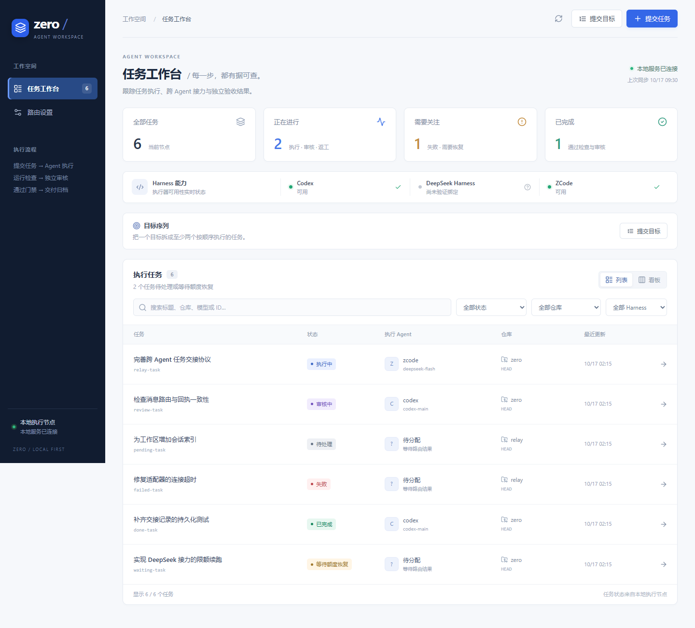

# Zero 项目研究与改进记录

研究日期：2026-10-17。起点：`main` 的 `f476413`。本轮改进分支：`codex/agent-workspace-improvements`。

## 产品与架构现状

Zero 已是一个可运行的本地编程任务执行节点。核心使用 Node.js 24、TypeScript、SQLite 和 Git worktree；网页使用 React 18、Vite 6 和 lucide 图标。HTTP API 和 CLI 共用任务状态源，Windows 版本通过用户手动启动的 launcher 与原生 guardian 管理服务进程树。

跨 agent 互通的现有实现是有序接力：一个任务拥有一个 worktree，不同 Harness 的执行阶段依次在其中工作；每阶段记录尝试、输入输出指纹和 HandoffV1。它没有实现任意 agent 的原生聊天历史迁移，也不是通用的实时群聊或并发共享写入系统。独立任务通过独立 worktree 隔离；有序任务序列通过前一步经核验的结果提交衔接。

已实现的交付链路包括路由、执行、检查、独立 Codex 审核、有限返工、提交和报告。路由器支持 Codex 或兼容 OpenAI API 的协调模型；执行适配器包括 Codex、DSH 和 ZCode；审核仍固定使用独立只读 Codex 会话。全局与项目执行预设逐字段继承。额度等待、租约、崩溃隔离和部分恢复协议均有持久记录与自动化测试。

## 当前进度与证据边界

- GitHub 最近八次 CI 记录均为成功，最新记录对应 `f476413`。这是已有 CI 的结果，本轮本机基线需另行运行。
- 真实任务记录已覆盖安装版 Codex 单任务、两步目标序列、一次单阶段执行崩溃恢复、GLM Flash 任务和 GLM Flash → DeepSeek Flash 两阶段接力。
- 三个桌面 API 模型有 selector 验证记录；DeepSeek Pro 的记录不能等同于完整任务验收。
- 真实 DSH 模型执行、Start Plan、自然额度耗尽与恢复、其他崩溃窗口、断电恢复仍未完成真实验收。
- 曾有 ZCode 写入后出现通用协议错误，原始原因仍未定位；后续成功不能证明偶发问题已修复。
- `docs/workspace-handoff-design.md` 的部分“当前”段落仍称双模型接力待完成，与较新的 `docs/live-validation.md` 和 README 不一致。历史设计、实现状态和最新验收需要明确区分。
- 仓库没有开放的 GitHub issue；不能据此判断没有 bug。现有 CI 构建前端，但未运行网页交互测试。

## 已确认的问题

| 问题 | 触发与根因 | 改进方向 |
| --- | --- | --- |
| 已执行任务隐藏检查结果 | `taskDetail()` 将检查放在 `task.tests`，`mapAttempt()` 不带检查；`TaskDrawer` 却只在 `attempts.length === 0` 时渲染任务检查 | 独立展示检查区，不以执行尝试数量为条件 |
| 跨 agent 接力在网页中不可观察 | TaskStore 已保存 stages/handoffs，详情 API 未投影，网页类型和详情视图也缺失 | 添加只读阶段、尝试角色和交接证据，展示真实路由、状态与改动文件 |
| 详情切换短暂显示上个任务 | `selectedId` 改变时未同步清除已有 `selected`，抽屉仍接收旧对象 | 只展示与选中 ID 相符的详情，隔离过期请求结果 |
| 轮询可能覆盖更新的结果 | 固定 interval 可发起重叠请求；先发的慢请求可能最后写入 | 使用请求序列或串行刷新，取消卸载后的请求 |
| 移动端隐藏其他导航入口 | 850px 以下 CSS 隐藏 `.nav-item:not(.active)` | 保留每个入口、可访问名称和键盘可见焦点 |
| 调度状态提示不真实 | 任务页始终显示“自动调度已开启”，即使服务断开 | 仅显示已核实的连接和刷新状态 |
| 初次提交容易缺少验证命令 | 表单暗示检查命令可省略；worker 无任何检查时必然失败 | 在提交前说明检查要求并阻止缺少命令的网页提交 |
| 任务量增加后难以定位 | 八种状态都展开成窄列，没有搜索与仓库/状态筛选；字体大量使用 9–11px | 默认任务列表，保留看板切换，增加筛选、清晰排版及响应式布局 |
| 大范围正常改动被误判为快照失败 | `#finishExecutionStage()` 将超过 40 个文件或路径超过 512 字符当作完整快照失败，丢弃已计算的完整指纹 | 完整指纹照常验证，交接展示单独截断并记录省略风险；真实 Git 快照失败继续阻断 |
| 设置保存响应可能覆盖新编辑 | 保存期间仍可编辑字段，返回后直接用响应替换本地配置 | 保存期间冻结可编辑区域，明确保存状态 |

## 架构缺口与返工修复

1. **语义交接和阶段分工已在第二轮补齐基础链路。** 每阶段可选 `objective` 已贯通网页、CLI、API、持久化、路由和执行提示；执行最终自述保存为有界 `executorSummary`，经来源与指纹核验后交给下一位 agent。自述保持非可信，不自动填写机器决策或检查结论。详见[第二轮深入审查](2026-10-17-semantic-relay-audit.md)。
2. **审核返工中的完整性失败已修复。** 原代码在用户检查全部退出 0、工作树却发生变化时，只在旧检查记录保存 `__zero_worktree_integrity__`；持久 check-run results 只有通过结果，因而不能使用剩余返工次数。真实 worker 回归先复现此失败，再验证修复后由 3 次执行、2 次审核到达 `done`。新增 append-only `check_run_integrity_failures`，绑定准确 run/task/owner/generation、原快照及新鲜 Git 证据，用户检查 ID 集合保持原样。只允许已核验的同分支、同 HEAD、允许范围内内容变化进入返工；分支移动、未知 I/O、越界写入及后续指纹失败继续停止。首次消费失败时，持久失败指纹、已结束阶段输出指纹和新鲜工作树指纹必须一致；重启与重复调用不能重复消耗 revision。77 项存储测试、6 项真实工作区流程测试通过，独立复审验证两个重启绕过场景均已拒绝。

## 本轮设计与范围

用户要求直接自主改进、不再提问。以下是实施判断，不视作用户指定的视觉细节。

沿用现有技术栈和任务状态机，将网页整理为跨 agent 工作台：深色紧凑导航、浅色内容区、清晰的连接状态、运行/待处理/待介入/完成概览、可搜索和筛选的任务列表，以及可切换看板。接力过程在任务详情中按真实阶段顺序呈现，包含 Harness、模型、角色、输入输出指纹、交接摘要、变更文件和后续步骤。没有证据时明确显示未产生交接，不生成示例或虚假运行状态。

保留任务提交、目标序列和执行预设功能；修复详情状态、检查可见性、错误信息、导航和异步刷新问题。接口扩展为 additive；不改变 DONE 门禁、权限策略、用户 Harness 配置或真实模型绑定。任何新的核心 bug 先由复现与回归测试确认再修复。

## 验收与 Git 记录

每个独立改动先验证再提交并推送此分支。验证包括核心测试、前端构建、HTTP API 回归和真实浏览器场景；网页覆盖任务切换、失败恢复、检查可见性、阶段交接、搜索筛选和窄屏导航。浏览器使用隔离测试数据，不调用真实模型或修改生产数据。最终记录具体结果及仍未验证的限制。

本文件会随着调研和实测补充，不将计划写成已完成事实。

## 执行记录

- `6aebeaa`：项目研究与实施计划。
- `3c2b464`：网页请求支持中止、20 秒等待上限和可读 JSON 错误；3 项 Node 回归通过，已推送。
- 原始网页构建和公开文件扫描通过。隔离 Edge 浏览器复现：有 attempt 的任务检查不可见、handoff 不可见、375px 导航无法进入设置且页面宽度为 385px。测试数据仅用于隔离浏览器，不代表真实模型运行。
- 原始核心全套：329 项，322 通过、7 失败，约 10 分 29 秒。7 项失败全部是 Windows 临时测试目录的 `EBUSY` 清理错误，没有业务断言失败。相关 fixture 加入有限清理重试后，24 项 Git/恢复测试与 24 项服务端测试均通过。返工证据改动前的集成全套 337 项全部通过；最终代码的完整 Linux/Windows 结果见 [PR 检查](https://github.com/Jonty-Zhang/Zero/pull/1/checks)，不把早先快照的结果当作新快照的验证。
- `5627bf1`：新增阶段、交接、attempt 身份与检查日志 API，独立审查无 P1/P2；24 项服务端测试通过。
- `d60f279`：覆盖响应体读取期间的超时与调用者中止；新增真实本地 HTTP 服务回归，6 项请求测试通过，独立复审通过。
- `1f34cc8`：分离完整 Git 指纹和有界交接展示，5 项真实 Git 回归覆盖 41/201 文件、长路径、省略文件迟到写入和指纹异常；另有 10 项相关回归通过，独立审查通过。
- `67d2530`：Windows 测试清理有限重试，忽略所有 `.zero-*` 临时测试目录。
- `3c20a74`：任务工作台及交互回归。13 项组件/轮询测试与生产构建通过；独立审查发现并修复 summary 焦点循环遗漏，真实 Edge Tab 复验通过。Edge 实测阶段与交接、检查输出、桌面/窄屏导航、设置保存、搜索筛选、列表/看板、必填检查提交、Escape 和断线缓存提示均通过，375px 页面宽度为 375px，无浏览器控制台异常。
- `8165650`：将 Windows 核心、网页及请求测试拆为独立 CI 步骤，避免 PowerShell 后续成功命令掩盖前面的失败；发布暂存测试也明确检查退出码。
- `b2b760d`：搜索只承诺列表实际提供的标题、仓库、模型和任务 ID，测试 fixture 与真实列表契约一致。完整描述检索需要单独的服务端查询接口，不在轮询中传送全部历史长提示词。
- `20c05ae`：持久化独立完整性失败证据，补齐首次消费和重启的三方指纹核验；存储 77 项、真实工作区流程 6 项定向测试通过，独立复审无遗留 P1/P2。
- 新启用的 Windows 核心 CI 揭示 23 个此前被掩盖的测试失败：22 个与 runner 的 8.3 临时目录别名和规范路径不一致有关，另一个错误地要求超时终止的退出码必须为 `null`。测试入口在进程内规范化 TEMP/TMP/TMPDIR，终止测试保留 `timed_out` 及错误断言并接受非零退出码。生产路径和符号链接门禁未放宽。81 项相关测试通过；一次性 junction 临时目录探针验证修复前路径身份不一致、修复后匹配，且不修改系统环境设置。
- 本轮保留专用分支；推送使用已登录的 GitHub CLI 非交互认证，避免系统凭据管理器等待交互。

## 界面预览

以下为隔离示例数据的实际浏览器截图，用于展示布局与交互；不代表新的真实模型验收。真实提供方验证边界仍以前述记录为准。

## 仍待推进

- 逐阶段目标和有界执行自述已实现；后续可研究更细的语义产物格式与质量评价，现有接力不迁移原生聊天历史。
- 定位历史 ZCode 偶发协议错误；已有成功重试不足以证明根因解决。
- 对 DSH、Start Plan、自然额度恢复及更多崩溃边界做独立真实验收。本轮未调用真实模型或修改生产数据，不将隔离回归扩大为这些场景已验证。
- 任务历史分页、服务端全文检索和按阶段读取大日志可作为后续性能工作；当前详情仍汇总该任务的已保存日志。
